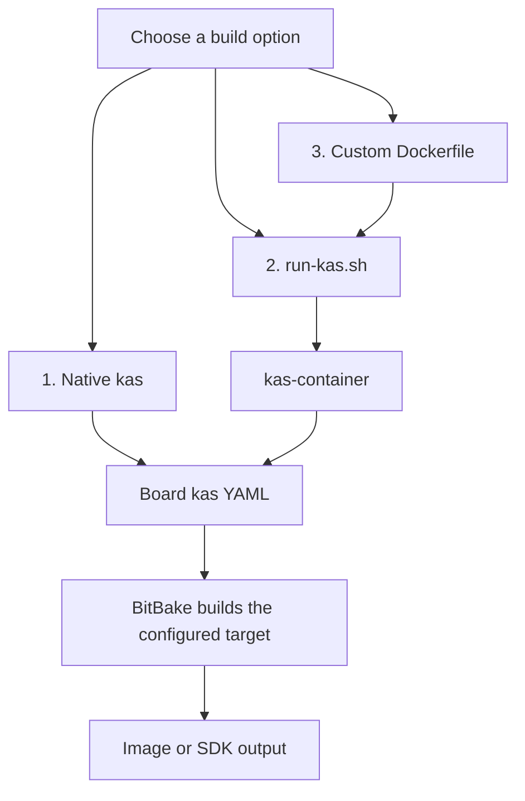
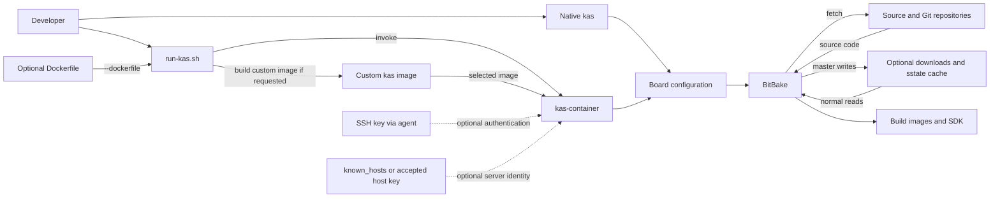

# yocto-board-lab

A Yocto project repository for building Embedded Linux images across multiple development boards.

## Table of Contents

- [1. Overview](#1-overview)
- [2. Supported Boards](#2-supported-boards)
- [3. Upcoming Boards](#3-upcoming-boards)
- [4. Prerequisites](#4-prerequisites)
  - [4.1 Start the docker service](#41-start-the-docker-service)
  - [4.2 Add current user to the docker group](#42-add-current-user-to-the-docker-group)
  - [4.3 Run the hello world docker image](#43-run-the-hello-world-docker-image)
  - [4.4 SSH access for private repositories](#44-ssh-access-for-private-repositories)
- [5. Board Documentation](#5-board-documentation)
- [6. Build Instructions](#6-build-instructions)
  - [6.1 Option 1: Native `kas` build](#61-option-1-native-kas-build)
  - [6.2 Option 2: `kas-container` with `run-kas.sh`](#62-option-2-kas-container-with-run-kassh)
  - [6.3 Option 3: Custom Docker image](#63-option-3-custom-docker-image)
  - [6.4 BeagleBone Black](#64-beaglebone-black)
  - [6.5 BeagleY-AI](#65-beagley-ai)
  - [6.6 Raspberry Pi 5](#66-raspberry-pi-5)
  - [6.7 Radxa Zero 3W](#67-radxa-zero-3w)
  - [6.8 FRDM-iMX8M Plus](#68-frdm-imx8m-plus)
  - [6.9 Arm QEMU (qemuarm)](#69-arm-qemu-qemuarm)
  - [6.10 Arm64 QEMU (qemuarm64)](#610-arm64-qemu-qemuarm64)
  - [6.11 Common BitBake commands](#611-common-bitbake-commands)
- [7. Running QEMU](#7-running-qemu)
- [8. Status Matrix](#8-status-matrix)
- [9. Notes](#9-notes)
- [10. Using `run-kas.sh` with shared downloads and sstate-cache](#10-using-run-kassh-with-shared-downloads-and-sstate-cache)
  - [10.1 Example: use existing pre-fetched downloads and sstate-cache](#101-example-use-existing-pre-fetched-downloads-and-sstate-cache)
  - [10.2 Example: populate the shared cache directory from the container](#102-example-populate-the-shared-cache-directory-from-the-container)
- [11. Backup and restore of downloads and sstate-cache](#11-backup-and-restore-of-downloads-and-sstate-cache)
  - [11.1 Backup](#111-backup)
  - [11.2 Restore](#112-restore)
- [12. Inspect a generated root filesystem image](#12-inspect-a-generated-root-filesystem-image)
- [13. Contributing](#13-contributing)

## 1. Overview

This repository provides Yocto build support, board metadata, and example commands for:

- BeagleBone Black
- BeagleY-AI
- Raspberry Pi 5

It also includes work-in-progress support for additional boards and planned BSP integrations.

## 2. Supported Boards

- BeagleBone Black
- BeagleY-AI
- Raspberry Pi 5
- FRDM-iMX8MP
- Radxa Zero 3W

## 3. Upcoming Boards

- Nvidia Jetson Orin Nano DevKit/Nvidia Jeston Orin Nano Module 8GB
- Radxa Rock 5T
- MilkV Duo S

## 4. Prerequisites

Install the required packages on Ubuntu/Debian:

```bash
sudo apt update
sudo apt install -y python3 python3-pip python3-venv docker.io containerd bmap-tools
```

Validate docker support:

### 4.1 Start the docker service

```bash
sudo systemctl start docker
```

### 4.2 Add current user to the docker group

```bash
sudo groupadd docker
sudo usermod -aG docker $USER
newgrp docker
```

### 4.3 Run the hello world docker image

```bash
docker run hello-world
```

### 4.4 SSH access for private repositories

If any configured source repository requires SSH authentication, start an SSH agent on the host and add your key:

```bash
eval "$(ssh-agent -s)"
ssh-add ~/.ssh/id_ed25519
```

With `run-kas.sh`, use `--ssh-key` instead. The script adds the key to your running `ssh-agent` (or starts a temporary one and stops it on exit) and forwards the agent to the container:

```bash
./run-kas.sh --ssh-key ~/.ssh/id_ed25519 -- shell kas/boards/bbb.yaml
```

SSH-agent forwarding is only needed for private SSH repositories; public sources do not require it.

If a build fails because git cannot verify the server's identity (the "authenticity of host can't be established" prompt cannot be answered inside the container), pre-trust the host with `--ssh-known-host`. The script fetches the host key with `ssh-keyscan`, prints its fingerprint (compare it with your Git provider's published fingerprints), and makes it available to the container. The option can be repeated and accepts `host:port`:

```bash
./run-kas.sh --ssh-key ~/.ssh/id_ed25519 --ssh-known-host github.com --ssh-known-host git.example.com:2222 -- shell kas/boards/bbb.yaml
```

Alternatively, `--ssh-accept-new-hosts` automatically trusts hosts seen for the first time (changed keys are still rejected). It is convenient but less strict. Both options require `--ssh-key`.

If you already have trusted server keys in a `known_hosts` file, pass it with `--ssh-known-hosts-file` instead of fetching the entries again:

```bash
./run-kas.sh --ssh-key ~/.ssh/id_ed25519 --ssh-known-hosts-file ~/.ssh/known_hosts -- shell kas/boards/bbb.yaml
```

The script copies the file into a temporary SSH directory mounted read-only into the container. You can combine this option with `--ssh-known-host` to add hosts or `--ssh-accept-new-hosts` to trust first-seen hosts.

## 5. Board Documentation

Board-specific documentation for supported and in-progress targets is available under the docs folder:

- [Beaglebone-black](docs/Beaglebone-black/README.md)
- [BeagleY-AI](docs/BeagleY-AI/README.md)
- [FRDM-i.MX8MP](docs/FRDM-i.MX8MP/README.md)
- [Jetson-Orin-Nano](docs/Jetson-Orin-Nano/README.md)
- [MilkV-Duo-S](docs/MilkV-Duo-S/README.md)
- [Qemu-arm](docs/Qemu-arm/README.md)
- [Qemu-arm64](docs/Qemu-arm64/README.md)
- [Radxa-Rock-5T](docs/Radxa-Rock-5T/README.md)
- [Radxa-Zero-3W](docs/Radxa-Zero-3W/README.md)
- [Raspberry-Pi-5](docs/Raspberry-Pi-5/README.md)

## 6. Build Instructions

Choose one of the following build options. The examples below build the BeagleBone Black image; replace `kas/boards/bbb.yaml` with the configuration for another board as needed.

**Build workflow at a glance**



**Build data flow**



`normal` builds can reuse the shared downloads and sstate cache; `master` builds populate or refresh it. SSH inputs are only needed for private SSH repositories.

### 6.1 Option 1: Native `kas` build

This builds directly on the host and requires the Yocto build dependencies to be installed there.

```bash
sudo apt update
sudo apt install -y build-essential chrpath cpio debianutils diffstat file gawk gcc git iputils-ping libacl1 libcrypt-dev locales python3 python3-git python3-jinja2 python3-pexpect python3-pip python3-subunit socat texinfo unzip wget xz-utils zstd python3-venv
python3 -m venv .venv
.venv/bin/pip install -r requirements.txt
```

Run the board's configured build target with `kas`:

```bash
MIRROR_DATA_PATH="$HOME/yocto/yocto_data" .venv/bin/kas build kas/boards/bbb.yaml
```

`MIRROR_DATA_PATH` is optional; when omitted, the project defaults to `$HOME/yocto_data`. The default `BUILD_TYPE` is `normal`, which reuses caches from this path when they exist.

### 6.2 Option 2: `kas-container` with `run-kas.sh`

This runs the build in the standard kas container, avoiding installation of Yocto build dependencies on the host. The script creates a Python virtual environment and installs `kas==5.4` automatically if needed. Docker must be installed and available to your user.

```bash
./run-kas.sh --shared-dir "$HOME/yocto/yocto_data" -- shell kas/boards/bbb.yaml -c "bitbake core-image-full-cmdline"
```

Omit `--shared-dir` if you do not want to persist or reuse the downloads and sstate cache on the host:

```bash
./run-kas.sh -- shell kas/boards/bbb.yaml -c "bitbake core-image-full-cmdline"
```

See [Using `run-kas.sh` with shared downloads and sstate-cache](#using-run-kassh-with-shared-downloads-and-sstate-cache) for the `normal` and `master` cache modes and other wrapper options.

### 6.3 Option 3: Custom Docker image

Use the repository's [board_farm.DockerFile](board_farm.DockerFile) to build a custom Ubuntu 24.04 image with the kas dependencies and `kas` installed. The image uses `/builder` as the builder user's home so the wrapper's shared-cache mount is available at the default cache path.

```bash
./run-kas.sh --dockerfile board_farm.DockerFile --shared-dir "$HOME/yocto/yocto_data" -- shell kas/boards/bbb.yaml -c "bitbake core-image-full-cmdline"
```

`run-kas.sh` builds the image from the given Dockerfile (tagged `yocto-board-lab-custom` by default; change with `--image-name`, and set the build context with `--docker-context`) and runs `kas-container` with it. Any Dockerfile that provides `kas` can be passed this way. The same command works without `--shared-dir` if you do not need a shared cache.

The board-specific examples below use `run-kas.sh` (Option 2). For Option 1, replace the wrapper call with `.venv/bin/kas build <kas-file-path>`.

### 6.4 BeagleBone Black

```bash
./run-kas.sh -- shell kas/boards/bbb.yaml -c "bitbake -c cleanall core-image-full-cmdline && bitbake core-image-full-cmdline"
```

### 6.5 BeagleY-AI

```bash
./run-kas.sh -- shell kas/boards/beagley-ai.yaml -c "bitbake -c cleanall arago-base-image && bitbake arago-base-image"
```

### 6.6 Raspberry Pi 5

```bash
./run-kas.sh -- shell kas/boards/rpi5.yaml -c "bitbake -c cleanall core-image-full-cmdline && bitbake core-image-full-cmdline"
```

### 6.7 Radxa Zero 3W

```bash
./run-kas.sh -- shell kas/boards/radxa-zero-3w.yaml -c "bitbake -c cleanall core-image-full-cmdline && bitbake core-image-full-cmdline"
```

### 6.8 FRDM-iMX8M Plus

```bash
./run-kas.sh -- shell kas/boards/frdm-imx8mp.yaml -c "bitbake -c cleanall core-image-full-cmdline && bitbake core-image-full-cmdline"
```

### 6.9 Arm QEMU (qemuarm)

```bash
./run-kas.sh -- shell kas/boards/qemuarm.yaml -c "bitbake -c cleanall core-image-full-cmdline && bitbake core-image-full-cmdline"
```

### 6.10 Arm64 QEMU (qemuarm64)

```bash
./run-kas.sh -- shell kas/boards/qemuarm64.yaml -c "bitbake -c cleanall core-image-full-cmdline && bitbake core-image-full-cmdline"
```

### 6.11 Common BitBake commands

Run these commands inside the `kas` shell to build or clean individual recipes, build a complete image, or create an SDK:

```bash
# Clean and rebuild a recipe
bitbake -c cleanall example && bitbake example

# Build the configured image
bitbake core-image-full-cmdline

# Build an SDK for the configured image
bitbake -c populate_sdk core-image-full-cmdline
```

The board's SDK output directory is configured in [kas/common/common.yaml](kas/common/common.yaml) as `build/boardfarm/sdk/<machine>/`.

## 7. Running QEMU

To boot the QEMU-built image:

```bash
# Build the image first using kas-container
./run-kas.sh -- shell kas/boards/qemuarm.yaml -c "bitbake -c cleanall core-image-full-cmdline && bitbake core-image-full-cmdline"
# Run the image in qemu using kas command
kas -- shell kas/boards/armqemu.yaml -c "runqemu qemuarm nographic slirp"
```

In the `runqemu` command:

- `nographic` disables the graphical display and uses the terminal for the QEMU
  console.
- `slirp` enables user-mode networking, so QEMU does not need a TAP device or
  root privileges. `runqemu` forwards host port `2222` to guest port `22` and
  host port `2323` to guest port `23` by default. Connect to a forwarded port
  on the host (for example, `ssh -p 2222 root@127.0.0.1`) if the corresponding
  service is running in the guest.

## 8. Status Matrix

| Status | Board                          | Image                     | Notes                                     |
|--------|--------------------------------|---------------------------|-------------------------------------------|
| ⬜     | qemuarm                        | core-image-full-cmdline   | Successfully boots in QEMU when built with `kas`; currently fails to boot when built with `run-kas.sh`.  |
| ⬜     | qemuarm64                      | core-image-full-cmdline   | Successfully boots in QEMU when built with `kas`; currently fails to boot when built with `run-kas.sh`.  |
| ✅     | Raspberry Pi 5                 | core-image-full-cmdline   | Successfully booted                       |
| ✅     | FRDM-iMX8MP                    | core-image-full-cmdline   | Successfully booted, AI Validation pending|
| ✅     | BeagleBone Black               | core-image-full-cmdline   | Successfully booted                       |
| ✅     | BeagleY-AI Rev-A               | arago-base-image          | Successfully booted, AI validation pending|
| ✅     | Radxa Zero 3W                  | core-image-full-cmdline   | Successfully booted                 |
| ⬜     | Radxa Rock 5T                  | core-image-full-cmdline   | RK3588 support evaluation                 |
| ⬜     | MilkV Duo S                    | core-image-full-cmdline   | Vendor BSP review required                |
| ⬜     | NVIDIA Jetson Orin Nano DevKit | demo-image-base   | Image build complete successfully, boot up is pending    |

## 9. Notes

- Update `kas/boards/*.yaml` if you add or modify board support.
- Use `bitbake -c cleanall <image>` to ensure clean builds after recipe or layer changes.
- If you encounter missing dependencies, verify the current Yocto and KAS documentation for your host distribution.

## 10. Using `run-kas.sh` with shared downloads and sstate-cache

The wrapper script will create a Python virtual environment in `.venv` and install `kas==5.4` automatically if needed. It forwards the arguments after `--` directly to `kas-container`.

- Host networking is enabled by default. Pass `--no-host-network` before `--` to omit `--network host` from the container runtime arguments. Without host networking, reaching services forwarded by QEMU from the host may require additional container network or port-forwarding configuration.
- `--shared-dir <directory>` mounts the host directory at `/builder/yocto_data` inside the container.
- `--build-type normal` is the default mode (used when `--build-type` is omitted) and does not require `--shared-dir` unless you want to reuse or persist caches on the host.
- `--build-type master` requires `--shared-dir` and is used when you want the container to read from and write to a host-side shared `downloads`/`sstate-cache` directory.

### 10.1 Example: use existing pre-fetched downloads and sstate-cache

If you already have the host cache in `$HOME/yocto/yocto_data`, run:

```bash
./run-kas.sh --shared-dir "$HOME/yocto/yocto_data" -- shell kas/boards/bbb.yaml
```

This mounts the existing host cache into the container so the build can reuse it.

### 10.2 Example: populate the shared cache directory from the container

If you want the build to populate or update the shared host cache, run:

```bash
./run-kas.sh --build-type master --shared-dir "$HOME/yocto/yocto_data" -- shell kas/boards/bbb.yaml
```

`--build-type master` makes the wrapper enforce the shared directory requirement and enables the build environment to persist downloads and `sstate-cache` to the host path.

## 11. Backup and restore of downloads and sstate-cache

The shared cache directory (`MIRROR_DATA_PATH`, containing `downloads` and `sstate-cache`) is wired up in [kas/common/common.yaml](kas/common/common.yaml). If `MIRROR_DATA_PATH` is not set it defaults to `${HOME}/yocto_data`.

How the build uses it:

- `BUILD_TYPE=normal` (default): if the directory exists, `own-mirrors` is enabled. Sources are fetched from `${MIRROR_DATA_PATH}/downloads/` (`SOURCE_MIRROR_URL`) and sstate objects from `${MIRROR_DATA_PATH}/sstate-cache/` (`SSTATE_MIRRORS`) before anything is downloaded or rebuilt. The directory is only read.
- `BUILD_TYPE=master`: `DL_DIR` and `SSTATE_DIR` point to `${MIRROR_DATA_PATH}/downloads` and `${MIRROR_DATA_PATH}/sstate-cache`, and mirror tarballs are generated, so the directory is populated or refreshed.

With `run-kas.sh`, the host directory given by `--shared-dir` is mounted at `/builder/yocto_data` in the container.

### 11.1 Backup

1. Populate or refresh the cache with a `master` build:

   ```bash
   ./run-kas.sh --build-type master --shared-dir "$HOME/yocto/yocto_data" -- shell kas/boards/bbb.yaml
   ```

2. Archive the directory:

   ```bash
   cd "$HOME/yocto"
   zip -r yocto_data.zip yocto_data
   ```

### 11.2 Restore

1. Copy `yocto_data.zip` to the target Linux host, then extract it under `$HOME/yocto`:

   ```bash
   cd "$HOME/yocto"
   unzip yocto_data.zip
   ```

2. Verify that the `downloads` and `sstate-cache` directories exist:

   ```bash
   ls -al "$HOME/yocto/yocto_data"
   ```

3. Build in `normal` mode against the restored cache.

   With `run-kas.sh`:

   ```bash
   ./run-kas.sh --shared-dir "$HOME/yocto/yocto_data" -- shell kas/boards/bbb.yaml
   ```

   With a local `kas` install:

   ```bash
   export MIRROR_DATA_PATH=$HOME/yocto/yocto_data
   kas shell kas/boards/bbb.yaml -c "bitbake core-image-full-cmdline"
   ```

## 12. Inspect a generated root filesystem image

1. `sudo mkdir -p /mnt/image/`  
   Create the mount point directory as root, including parent directories if needed.

2. `pushd build/boardfarm/images/radxa-zero-3w`  
   Change into the image output directory and save the previous location.

3. `sudo mount -o loop core-image-full-cmdline-radxa-zero-3w.rootfs.ext4 /mnt/image/`  
   Mount the `.ext4` rootfs image file to image using a loopback device.

4. `ls -al /mnt/image`  
   List the mounted filesystem contents in long format, including hidden files.

5. `popd`  
   Return to the original directory saved by `pushd`.

## 13. Contributing

Contributions are welcome. Please open issues or provide patches for:

- new board support
- BSP updates
- image configuration improvements
- build and runtime troubleshooting
